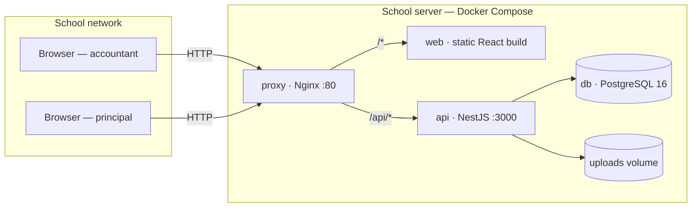
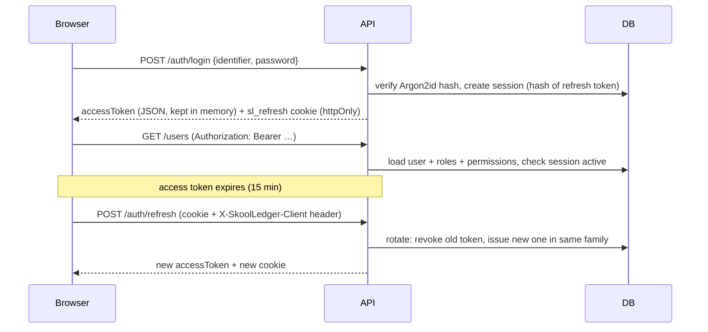

# Architecture

SkoolLedger is a **modular monolith**: one API process, one web app, one
PostgreSQL database, deployed together with Docker Compose. This keeps a
single-server school installation simple and reliable, while module
boundaries keep the codebase maintainable as finance modules are added.

## Runtime view



- **proxy** is the only published port. It adds security headers, overwrites
  `X-Forwarded-For` with the real client address (so audit IPs cannot be
  spoofed) and tags requests with `X-Request-Id`.
- **web** serves the compiled React app; all routes fall back to `index.html`.
- **api** applies migrations and syncs roles/permissions on start, then serves
  `/api/v1/*`.
- **db** is never exposed to the network.

## Monorepo packages

| Package           | Role                                                                                                                                                                                                       |
| ----------------- | ---------------------------------------------------------------------------------------------------------------------------------------------------------------------------------------------------------- |
| `packages/shared` | The contract between browser and server: permission codes, built-in roles, Zod validation schemas, API response types, constants. Compiled to CommonJS for the API; consumed as TypeScript source by Vite. |
| `packages/ui`     | shadcn/ui-style components (Button, Input, Card, Dialog, Table, …) on Radix UI + Tailwind. Owned code, not a runtime dependency on a vendor.                                                               |
| `apps/api`        | NestJS application.                                                                                                                                                                                        |
| `apps/web`        | React application.                                                                                                                                                                                         |

**One source of truth for rules.** A form field's validation message on screen
comes from the same Zod schema the API uses to reject the request. Permission
codes that hide a menu item are the same codes the API guard enforces.

## API structure

```
src/
  main.ts / app.setup.ts   bootstrap; helmet, cookies, trust proxy, prefix
  app.module.ts            module registry + global guards/filter
  config/                  Zod-validated environment (fails fast on bad config)
  common/                  decorators, pipes, filters, middleware, request types
  database/                PrismaService, idempotent seed
  storage/                 StorageDriver abstraction, LocalDiskStorage
  modules/
    auth/                  login, refresh, logout, change password, JWT guard
    users/                 user administration
    roles/                 role listing, anti-escalation checks
    permissions/           permission catalogue, PermissionsGuard
    schools/               current school
    settings/              school settings, logo, public branding
    audit/                 AuditService (global) + audit log API
    health/                liveness + database check
```

### Request lifecycle

1. `RequestIdMiddleware` assigns/propagates a request id.
2. **ThrottlerGuard** — global rate limit, plus a stricter `credentials`
   limit on routes marked `@CredentialThrottle()`.
3. **JwtAuthGuard** (global) — skips `@Public()` routes; otherwise verifies
   the access token, loads the user, roles and permissions **fresh from the
   database**, checks the login session is still active, and blocks everything
   except `@AllowPendingPasswordChange()` routes while a password change is
   required.
4. **PermissionsGuard** (global) — enforces `@RequirePermissions(...)`.
5. `ZodValidationPipe` validates body/query with the shared schema.
6. Controller → service. Services scope every query by `schoolId` and write
   audit entries **inside the same transaction** as the change.
7. `AllExceptionsFilter` returns a uniform `ApiErrorBody`
   (`statusCode, error, message, code?, fieldErrors?, requestId`), maps Prisma
   unique violations to 409 with field errors, and never leaks internals.

### Anatomy of a module (template for Milestones 2–12)

```
modules/students/
  students.module.ts
  students.controller.ts   thin: decorators, validation pipe, @Actor()
  students.service.ts      business rules, transactions, audit calls
  students.mapper.ts       Prisma model → DTO (optional)
  *.spec.ts                unit tests
```

Checklist when adding a module:

1. Add permission codes in `packages/shared/src/permissions.ts` and grant them
   to roles in `roles.ts` (the seed syncs them on next start).
2. Add Zod schemas and DTO types to `packages/shared`.
3. Add Prisma models with `schoolId`, timestamps, indexes; create a migration.
4. Add audit action codes to `AUDIT_ACTIONS` and call `AuditService.record`
   inside the transaction for every create/update/reversal.
5. Register the module in `app.module.ts`.
6. Web: add a feature folder, register the route in `app/router.tsx`, and
   remove the `comingSoon` entry in `app/navigation.ts`.
7. Integration tests for permissions, validation and audit entries.

## Authentication and sessions



- A reused (already rotated) refresh token outside a 30-second grace window
  revokes the whole session family and is audited as
  `auth.refresh_reuse_detected`.
- The grace window lets two browser tabs refresh at the same moment without
  logging the user out.
- The web client refreshes proactively every 10 minutes and transparently
  retries a request once after a 401.

## Web application structure

```
src/
  main.tsx               providers: React Query, Auth, Router, Toaster
  app/router.tsx         routes; permission-wrapped pages
  app/navigation.ts      sidebar + "coming soon" routes from one definition
  components/            AppShell, Sidebar, DataTable, Pagination, states
  features/<area>/       pages, dialogs and API hooks per feature
  lib/api-client.ts      fetch wrapper: token, refresh, errors, events
```

UI principles: restrained navy/grey palette, system fonts (works offline),
tabular numerals, visible loading/empty/error states, no invented data.

## Storage

`StorageDriver` is an abstract class with `put/get/delete` by opaque key.
Phase 1 binds it to `LocalDiskStorage` (`UPLOAD_DIR`, a Docker volume). An
S3-compatible driver (e.g. self-hosted MinIO) can be bound in
`storage.module.ts` for hosted deployments without touching callers. Uploaded
images are identified by their bytes, never by name or browser MIME type.

## Reporting engine (planned, Milestone 5)

Fee vouchers, receipts, salary slips and reports will be rendered from
HTML/CSS templates to PDF with Puppeteer, reusing the school branding stored
in Settings. Rendering will run in a bounded worker (queue with concurrency
limit) so bulk voucher generation cannot starve the API. Excel import/export
will use ExcelJS; charts will use Recharts.

## Hosting online later

Nothing in the code assumes a LAN. To host:

- point `DATABASE_URL` at a managed or self-hosted PostgreSQL,
- terminate HTTPS at the proxy and set `COOKIE_SECURE=true`,
- optionally switch the storage driver,
- for many schools on one instance, add school selection at login (code or
  subdomain); all data is already partitioned by `schoolId`.
