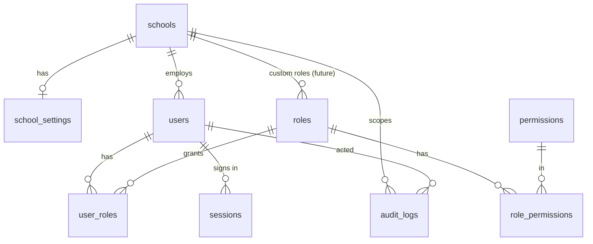

# Database

PostgreSQL 16, accessed through Prisma 6. Schema: `apps/api/prisma/schema.prisma`.
Migrations: `apps/api/prisma/migrations/`.

## Conventions

| Topic             | Rule                                                                                                                                           |
| ----------------- | ---------------------------------------------------------------------------------------------------------------------------------------------- |
| Keys              | UUID primary keys (`@db.Uuid`). No sequential ids exposed in URLs.                                                                             |
| Naming            | Prisma models in PascalCase; tables and columns in `snake_case` via `@@map` / `@map`.                                                          |
| Timestamps        | `created_at`, `updated_at` as `timestamptz(3)`; always UTC.                                                                                    |
| Tenant            | Every business table has `school_id` → `schools.id`, and every query filters by it.                                                            |
| Soft delete       | Master data (`schools`, `users`, `roles`, later students/staff/items) uses `deleted_at`. Deactivation (`is_active`) is separate from deletion. |
| Financial records | Never deleted or edited in place. Corrections are reversal entries that reference the original (from Milestone 4 onward).                      |
| Money             | `Decimal(14,2)` (`@db.Decimal(14, 2)`) — never `Float`. Currency is per school (`school_settings.currency`).                                   |
| Strings           | Bounded `VARCHAR(n)` matching the Zod limits in `packages/shared`. Blank optional values are stored as `NULL`.                                 |
| Case              | Emails and usernames are stored lower-case.                                                                                                    |
| Foreign keys      | `Restrict` by default so history cannot be silently removed; `Cascade` only for pure join/child rows (role_permissions, user_roles, sessions). |
| Indexes           | Every foreign key and every filter/sort used by a list screen.                                                                                 |

## Entity relationships (Phase 1)



## Tables

### `schools`

`id`, `name`, timestamps, `deleted_at`. The tenant. Most installations have one.

### `school_settings` (1:1 with school, PK = `school_id`)

`campus_name`, `address`, `phone`, `email`, `currency` (ISO 4217, default
`PKR`), `academic_session`, `bank_name`, `account_title`, `account_number`,
`iban`, `jazz_cash`, `easypaisa`, `logo_key` (storage key, not a path),
`logo_mime_type`, `logo_updated_at`, `updated_by_id`, timestamps.

### `users`

`school_id`, `full_name`, `email` (unique), `username` (unique),
`password_hash` (Argon2id), `is_active`, `must_change_password`,
`failed_login_attempts`, `locked_until`, `last_login_at`,
`password_changed_at`, `created_by_id`, timestamps, `deleted_at`.
Indexes: `(school_id, is_active)`, `(school_id, deleted_at)`.

### `roles`, `permissions`, `role_permissions`, `user_roles`

Roles have a unique `key` (`super_admin`, `school_admin`, `accountant`,
`operator`, `viewer`) and `is_system`. Built-in roles have `school_id = NULL`.
Permission `code`s (e.g. `settings.update`) are stable identifiers — never
rename one after release. `user_roles` records `assigned_by_id` and
`assigned_at`.

The seed (`apps/api/src/database/seed/seed.ts`) keeps these tables in sync
with `packages/shared` on every API start.

### `sessions`

One row per refresh token. `family_id` groups the rotation chain of one login
(it is also the `sid` in access tokens). `token_hash` is SHA-256 of the
token; `revoked_at` + `revoke_reason` (`rotated`, `logout`,
`password_changed`, `password_reset`, `user_deactivated`, `reuse_detected`),
`replaced_by_id`, `expires_at`, `ip_address`, `user_agent`.

### `audit_logs`

`school_id` (nullable for installation-level events such as a failed login
with an unknown username), `actor_id`, `action` (e.g. `user.roles_changed`),
`entity` (`User`, `School`, `Session`), `entity_id`, `previous_values`,
`new_values`, `metadata` (JSONB; includes `requestId`), `ip_address`,
`user_agent`, `created_at`.
Indexes: `(school_id, created_at DESC)`, `(entity, entity_id)`,
`(actor_id, created_at DESC)`, `(action)`.

**Append-only:** the initial migration installs triggers that reject
`UPDATE`, `DELETE` and `TRUNCATE` on `audit_logs`. Values containing
`password`, `token`, `secret` or `hash` in their key are stored as
`[REDACTED]`. Only changed fields are stored in before/after values.

Tracked in Phase 1: `auth.login`, `auth.login_failed`, `auth.logout`,
`auth.password_changed`, `auth.refresh_reuse_detected`, `user.created`,
`user.updated`, `user.password_reset`, `user.roles_changed`,
`settings.updated`, `settings.logo_updated`, `settings.logo_removed`.

## Migrations

```bash
# Development: edit schema.prisma, then
pnpm db:migrate --name add_students      # creates + applies a migration
# Production / Docker: applied automatically on API start
pnpm db:deploy                           # prisma migrate deploy
```

Rules:

- Migrations are committed and immutable once released. Fix forward with a
  new migration.
- Destructive changes (drop/rename column) are done in two releases: add new
  → migrate data → remove old.
- Hand-written SQL (triggers, check constraints, partial indexes) goes into
  the generated `migration.sql` before it is applied, as done for the audit
  trigger.
- Test migrations against a copy of real data (restore a backup into a
  scratch database) before release.

## Adding a business table (checklist)

```prisma
model Student {
  id        String    @id @default(uuid()) @db.Uuid
  schoolId  String    @map("school_id") @db.Uuid
  // ...
  createdAt DateTime  @default(now()) @map("created_at") @db.Timestamptz(3)
  updatedAt DateTime  @updatedAt @map("updated_at") @db.Timestamptz(3)
  deletedAt DateTime? @map("deleted_at") @db.Timestamptz(3)

  school School @relation(fields: [schoolId], references: [id], onDelete: Restrict)

  @@index([schoolId, deletedAt])
  @@map("students")
}
```

Plus: add the back-relation on `School`, scope every query by `schoolId`,
add unique constraints _per school_ (e.g. `@@unique([schoolId, admissionNo])`),
and audit every change.
